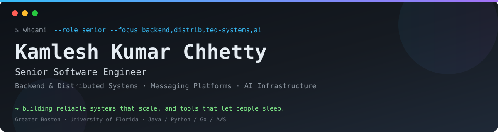

<div align="center">



<br/>

### Senior Software Engineer · Backend & Distributed Systems · AI, Infrastructure & Messaging Platforms

<p>
  <em>I build reliable systems that scale — and tools that let people sleep.</em>
</p>

<p>
  <a href="https://twitter.com/KamleshChhetty"></a>
  <a href="https://www.linkedin.com/in/kamleshchhetty/"></a>
  <a href="mailto:kamleshkc2002@gmail.com"></a>
  <a href="https://github.com/kamleshkc2002"></a>
</p>

<p>
  
</p>

📍 Greater Boston &nbsp;·&nbsp; 🎓 University of Florida

</div>

---

### `whoami` // About Me

```python
class KamleshKumarChhetty:
    role = "Senior Software Engineer"
    focus = [
        "Backend & Distributed Systems",
        "Messaging Platforms",
        "AI Infrastructure & Dev Productivity",
        "Reliable, Observable Services at Scale",
    ]
    stack = ["Java", "Python", "Go", "AWS"]
    interests = ["System Design", "Distributed Systems", "Applied AI", "Open Source"]
    currently_building = "Scalable messaging & customer engagement systems"
    status = "Open to conversations about backend, infrastructure, and AI"
```

- Passionate about **open source**, clean architecture, and engineering that values **ownership and measurable impact**
- Enjoy solving complex problems — from high-volume messaging to pragmatic **RDBMS vs. NoSQL** tradeoffs
- 💬 Ask me about anything and everything, especially system design and data at scale

---

### 🎯 Current Focus

- Building scalable backend & distributed systems that support real-world customer engagement
- Applying AI to **developer productivity, automation, and product experiences**
- Writing reliable, observable services — API design to deployment primitives
- Learning emerging tech in public and building with strong architecture

---

### `nmap -sV skills.local` // Tech Stack

**Backend & Languages**


**Cloud & Infra**


**Data**


---

### 📊 GitHub Activity

<div align="center">


<br/>

<br/>


</div>

---

### 🤝 Let's Connect

Whether you want to talk backend architecture, distributed systems, AWS, AI, open source, or just say hi — my inbox is open.

<div align="center">

[](https://twitter.com/KamleshChhetty)
[](https://www.linkedin.com/in/kamleshchhetty/)
[](mailto:kamleshkc2002@gmail.com)
[](https://github.com/kamleshchhetty)

</div>

---

<div align="center">

⭐ **Thanks for visiting — feel free to explore my repos and drop a follow!** ⭐

</div>
